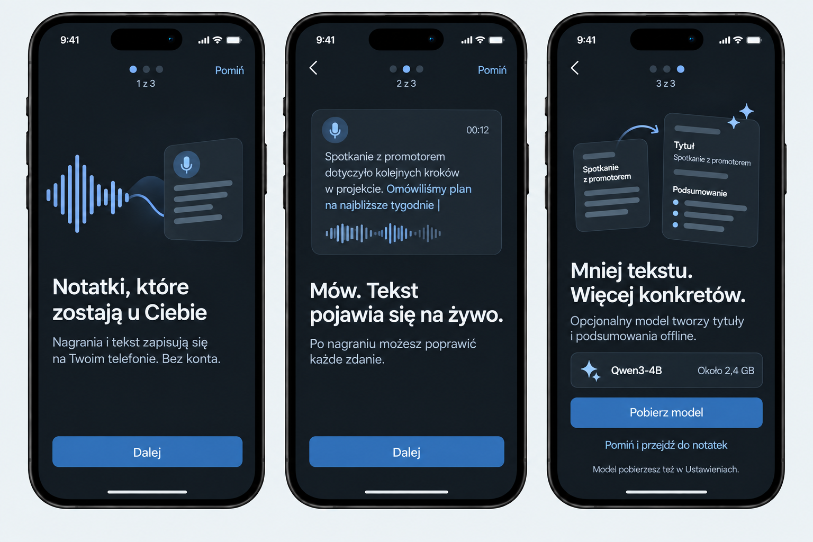
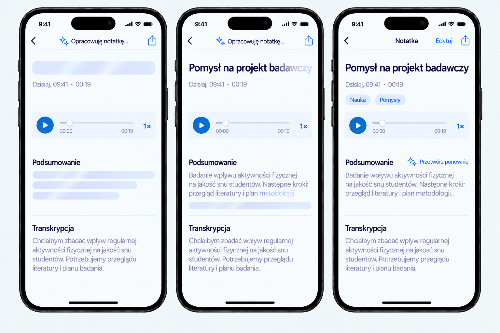

# Wizualizacje aplikacji Notatki

Referencyjny projekt interfejsu: 30 widoków w motywie jasnym i ciemnym, zebranych na 20 planszach. Zestaw zachowuje zaakceptowane wizualizacje, w tym ostatnią wersję wspólnego statusu opracowania notatki i układu kategorii.

## Przeglądanie

Po pobraniu repozytorium otwórz plik HTML bezpośrednio w przeglądarce. Nie potrzeba instalacji zależności, serwera ani połączenia z internetem. Zachowaj cały katalog `visualizations/` — strony korzystają ze wspólnych obrazów w `assets/`.

- **[Mapa przepływów](flows.html)** — ekrany połączone strzałkami, przejścia między krokami i powiększenie pojedynczego telefonu.
- **[Galeria plansz](index.html)** — cały zestaw, przełączanie motywu i pobieranie oryginalnych PNG.
- **[Demonstracja animacji](processing.html)** — opracowanie tytułu i podsumowania, pojawianie się tekstu oraz układ wielu kategorii. Przycisk „Odtwórz animację” uruchamia demonstrację; jest też wariant ograniczonego ruchu.

GitHub pokazuje pliki HTML jako kod. Poniższe odnośniki do PNG pozwalają oglądać plansze bezpośrednio na GitHubie.

## Plansze

| Zestaw                              | Jasny                                                   | Ciemny                                                 |
| ----------------------------------- | ------------------------------------------------------- | ------------------------------------------------------ |
| Lista notatek, dodawanie i zadania  | [PNG](assets/01-notes-and-tasks-light.png)              | [PNG](assets/01-notes-and-tasks-dark.png)              |
| Nagrywanie i transkrypcja           | [PNG](assets/02-recording-light.png)                    | [PNG](assets/02-recording-dark.png)                    |
| Notatka i ręczna edycja             | [PNG](assets/03-note-and-editing-light.png)             | [PNG](assets/03-note-and-editing-dark.png)             |
| Opracowanie notatki                 | [PNG](assets/04-processing-light.png)                   | [PNG](assets/04-processing-dark.png)                   |
| Ponowne przetwarzanie i wybór zmian | [PNG](assets/05-regeneration-light.png)                 | [PNG](assets/05-regeneration-dark.png)                 |
| Notatka ręczna i import audio       | [PNG](assets/06-manual-and-import-light.png)            | [PNG](assets/06-manual-and-import-dark.png)            |
| Model i ustawienia                  | [PNG](assets/07-settings-light.png)                     | [PNG](assets/07-settings-dark.png)                     |
| Wprowadzenie                        | [PNG](assets/08-onboarding-light.png)                   | [PNG](assets/08-onboarding-dark.png)                   |
| Puste stany i przerwane nagranie    | [PNG](assets/09-empty-and-error-states-light.png)       | [PNG](assets/09-empty-and-error-states-dark.png)       |
| Notatka tekstowa i propozycje zadań | [PNG](assets/10-text-note-and-task-proposals-light.png) | [PNG](assets/10-text-note-and-task-proposals-dark.png) |

### Wprowadzenie

### Opracowanie notatki

## Relacja do aplikacji

To makiety i demonstracja animacji, a nie zrzuty aktualnego buildu. Zawierają przykładowe treści. Kod aplikacji jest w [`app/src/`](../app/src/).

Wersja aplikacji rozwijana na podstawie tego projektu rozróżnia oczekiwanie w kolejce, wczytywanie modelu i opracowywanie notatki. Automatycznie proponuje najwyżej jedną kategorię główną; ręczna edycja pozwala wybrać wiele kategorii. Demonstracja pokazuje też warianty wielokategorii. Plansze nie potwierdzają działania pobierania w tle, powiadomień systemowych ani Live Activity.

## Pliki

- `assets/` — oryginalne PNG, bez zmiany obrazu lub kompresji stratnej; łącznie około 29 MB.
- `screens.js` — wspólny katalog obrazów dla galerii i mapy.
- `index.*`, `flows.*`, `processing.*` — niezależne strony HTML z lokalnymi stylami i skryptami, bez bibliotek zewnętrznych.

Przy edycji zachowaj wymiary plansz 1536 × 1024 px. Mapa przepływów używa współrzędnych wycięcia telefonów zapisanych w `flows.js`; zmiana kompozycji obrazu wymaga aktualizacji tych współrzędnych.
